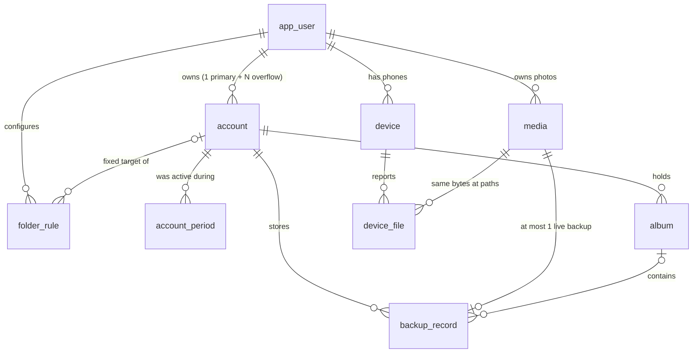

# Data model

## Where the "entities" are
- **Schema (source of truth):** `migrations/NNN_name.up.sql`, each with a `.down.sql`. They are embedded in the binary and applied in order by `go run ./cmd migrate` (also on `appserver` start). Applied versions are tracked in `schema_migrations`, and `make rollback n=1` reverts the newest.
  - 001 init
  - 002 one-live-backup
  - 003 To delete
  - 004 account ownership
  - 005 audit columns + soft-deleted rules
- **Entities:** `internal/entity/`, one struct per table (`Account`, `AccountPeriod`, `AppUser`, `Device`, `DeviceFile`, `Media`, `BackupRecord`, `Album`, `FolderRule`), embedding `BaseModel` (`id`, `created_at`, `updated_at`). Data only, no logic.
- **Enums:** `internal/enum/` holds typed values for every constrained column (`AccountRole`, `FileState`, `BackupStatus`, `FileSource`, `RuleBackup`, `RuleCleanup`, `PeriodEndReason`), each with `IsValid()`.
- **Repository projections:** queries that join tables return small purpose-built structs in `internal/infrastructure/repository/`:

| Struct (`repository`) | Reads from | Used for |
|---|---|---|
| `Account` (= `entity.Account`) | `account` | sign-in, tokens, roles |
| `Period` (db.go) | `account_period` | active periods |
| `FileMeta`, `UploadFile` (backup.go) | `media` + `device_file` | sync input, upload completion |
| `DeviceFileStatus` (cleanup.go) | `device_file` + live `backup_record` + `account` | cleanup decisions |
| `RestoreCandidate` (restore.go) | `device_file` + `media` + `backup_record` | restore |
| `MediaDetail`, `ToDeleteItem` (similar.go) | `media` + `device_file` + `backup_record` | Similar photos, To delete |
| `LiveRecord` (cloudcheck.go) | `backup_record` | cloud check |
| `AccountStats`, `TakenIn` (dashboard.go) | aggregates | dashboard, photos-by-date |
| `planner.Rule`, `planner.Account`, `planner.Photo` (`internal/planner`) | `folder_rule`, `account`, `media` | pure decision logic |

## Diagram


## Tables
Every table also has `created_at` and `updated_at` (the trigger `set_updated_at` keeps it current).

| Table | One row is… | Key columns | Rules enforced by the database |
|---|---|---|---|
| `app_user` | an **owner** (a person using the system) | `id`, `email` | `email` unique. Today a single local owner (`email = 'local'`) |
| `account` | a **Google account** linked to an owner | `user_id`, `email`, `google_sub`, `role` (primary/overflow), `active`, `full_flag`, `refresh_token_enc` (AES-GCM) | **A Google account belongs to one owner, ever** (unique `google_sub`, unique `lower(email)`). **One primary per owner.** Role ∈ {primary, overflow} |
| `account_period` | a span when an account was **the** backup destination | `account_id`, `started_at`, `ended_at`, `end_reason` (full/switched/manual) | At most one open period per owner (in code) |
| `device` | a **phone** | `user_id`, `model`, `first_scan_at` (= the start point) | — |
| `media` | a unique **photo content** (by bytes) | `user_id`, `sha256`, `phash`, `width`, `height`, `date_taken`, `gps_lat/lng` | unique (`user_id`, `sha256`): the same bytes are one media, wherever they are |
| `device_file` | a **file on a phone** at a path | `device_id`, `media_id`, `relative_path`, `display_name`, `size`, `source`, `state`, `present_on_device` | unique (`device_id`, path, name). `state` ∈ {existing_skip, pending, backed_up, excluded} |
| `backup_record` | a media **stored in an account** | `media_id`, `account_id`, `gphotos_media_item_id`, `product_url`, `album_id`, `status`, `marked_for_delete_at`, `verified_at`, `last_checked_at` | **At most one live backup per media** (unique `media_id` where status ∈ {uploaded, verified}). This is the "never upload twice" guarantee |
| `album` | a Google Photos **album** per account per phone folder | `account_id`, `folder_path`, `title`, `gphotos_album_id`, `product_url` | unique (`account_id`, `folder_path`). `folder_path = ':to-delete:'` is the "🗑 To delete" album |
| `folder_rule` | a **per-folder rule** | `user_id`, `path_glob`, `target_account_id`, `backup` (include/exclude), `cleanup` (allowed/protected), `priority`, `deleted_at` | Soft delete: replacing the rule set sets `deleted_at` on the old rules |

## How accounts are managed
```
owner (app_user)
 ├── primary account     exactly 1. Fixed target for rules like Documents → primary
 ├── overflow account    0..N. Used when the current account is full, first by id
 └── ...
```
- **Linking:** `/oauth/start?role=primary|overflow` (`application/account`). The backend stores the encrypted refresh token, plus the account's email and Google `sub` (its permanent id).
- **Ownership is exclusive.** Once a Google account is linked to an owner, as primary **or** overflow, it can't be linked to any other owner, as primary or anything else. This holds even if the account's email later changes, because `sub` is checked too. Trying gives HTTP 409 "already linked to another owner". The same owner reconnecting (token refresh) is fine.
- **One primary per owner.** A second primary gets a 409; connect it as overflow instead.
- **Which account receives new photos:** the one with the open `account_period` ("current"). When it's full, the next usable overflow account takes over: the period is closed with `end_reason = full` and a new one opens. Folders with a fixed target (e.g. Documents → primary) **never** fall back; they wait until that account has space.
- **Today there's one owner** (`DefaultUserID`), and the app ↔ backend connection has no login yet. Planned: the owner signs in to our app with their **primary Google account**, which becomes the owner's identity. Every overflow account hangs off that owner. The ownership rule above is already in place for that.
